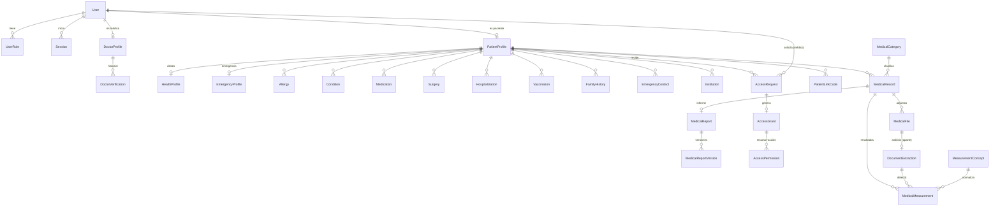

# Base de datos

PostgreSQL 14+ con **Prisma 7** (`prisma/schema.prisma`). Las migraciones están en `prisma/migrations/` y se aplican con `npm run db:deploy`.

## Convenciones

- Ids `cuid` (no secuenciales; no permiten adivinar recursos).
- Tablas en `snake_case` plural (`@@map`) y columnas en `camelCase`.
- Fechas clínicas sin hora (`@db.Date`); eventos con `timestamp(3)` en UTC.
- Toda información clínica cuelga de `PatientProfile` (`patientId`) y registra **origen** (`source`: `PATIENT` | `DOCTOR` | `SYSTEM`) y **autor** (`createdById`).
- Secretos y tokens: sólo hashes (SHA-256 o Argon2id) o cifrado autenticado (AES-256-GCM).

## Diagrama



`AuditEvent` no tiene relaciones a propósito (ver más abajo).

## Modelos

### Identidad y acceso a la cuenta

| Modelo | Propósito | Campos clave |
| --- | --- | --- |
| `User` | Identidad y credenciales | `email` (único, en minúsculas), `passwordHash` (Argon2id), `status`, `emailVerifiedAt`, `failedLoginCount`, `lockedUntil`, `mfaSecretEnc` (cifrado), `mfaEnabledAt`, `mfaLastUsedStep` |
| `UserRole` | Roles (una persona puede tener varios) | `(userId, role)` único; `grantedById` |
| `Session` | Sesiones revocables | `id` = SHA-256 del token, `publicId`, `expiresAt`, `lastSeenAt`, `ipAddress` (anonimizada) |
| `PasswordResetToken`, `EmailVerificationToken` | Enlaces de un solo uso | `tokenHash` único, `expiresAt`, `usedAt` |
| `MfaRecoveryCode` | Códigos de recuperación MFA | `codeHash` único, `usedAt` |

### Perfiles

| Modelo | Propósito |
| --- | --- |
| `PatientProfile` | Datos de identificación del paciente (nacimiento, sexo, documento, teléfono, provincia, ciudad) |
| `DoctorProfile` | Especialidad, matrícula, jurisdicción y `verificationStatus` (`PENDING` / `VERIFIED` / `REJECTED`); `(jurisdiction, licenseNumber)` único |
| `DoctorVerification` | Historial de decisiones de verificación (quién, cuándo, nota) |

### Información médica

| Modelo | Propósito |
| --- | --- |
| `HealthProfile` | Grupo sanguíneo, altura, peso (1:1) |
| `Allergy`, `Condition`, `Medication`, `Surgery`, `Hospitalization`, `Vaccination`, `FamilyHistory` | Una tabla por tipo de dato de "Mi salud" |
| `EmergencyContact`, `EmergencyProfile` | Contactos y qué muestra la ficha de emergencia |
| `MedicalCategory` | Catálogo **extensible** (slug, nombre, orden, activo). Las 20 categorías iniciales se insertan en la migración |
| `Institution` | Instituciones normalizadas **por paciente** (no se comparten entre pacientes) |
| `MedicalRecord` | Hecho médico fechado (estudio, consulta, receta…); unidad del historial y la búsqueda (`searchText` normalizado) |
| `MedicalFile` | Metadatos del archivo (clave aleatoria en el storage, MIME detectado, tamaño, SHA-256); los bytes viven en el storage |
| `MedicalReport` | Informe de un médico, con una copia fija del autor (nombre, matrícula, jurisdicción, especialidad) |
| `MedicalReportVersion` | Versiones del informe (**append-only**): título, contenido, motivo del cambio, autor, fecha y hash |

### Acceso médico

| Modelo | Propósito |
| --- | --- |
| `PatientLinkCode` | Código de vinculación de un solo uso (hash, vence a los 60 min) |
| `AccessRequest` | Solicitud del médico: `PENDING` / `APPROVED` / `REJECTED` / `CANCELLED`, vence a los 7 días |
| `AccessGrant` | Autorización paciente → médico: `ACTIVE` / `REVOKED` / `SUPERSEDED` / `EXPIRED`, `expiresAt` (null = permanente), `revokedAt` |
| `AccessPermission` | `resourceType` (`HEALTH_SECTION` / `RECORD_CATEGORY`) + `resourceKey` + `action` (`VIEW` / `UPLOAD` / `CREATE_MEDICAL_ENTRY`) |

Un grant es **vigente** si `status = ACTIVE`, `revokedAt IS NULL`, `expiresAt` es null o futura, y el médico sigue `VERIFIED`. Se evalúa en cada request.

### Procesamiento de estudios (Fase 6)

| Modelo | Propósito | Campos clave |
| --- | --- | --- |
| `DocumentExtraction` | Resultado del análisis automático de **un** archivo. Nunca reemplaza al original | `status` (`UPLOADED` → `PROCESSING` → `READY_FOR_REVIEW` → `CONFIRMED`, o `FAILED`), `method` (`PDF_TEXT` / `OCR`), `provider`, `text`, `suggestions` (metadatos propuestos con confianza), `metadataReviewed`, `errorCode` |
| `MeasurementConcept` | Catálogo **extensible** de indicadores normalizados (30 iniciales: glucemia, colesterol total/HDL/LDL, hemograma, función renal, tiroides…) | `code`, `displayName`, `aliases[]` (sinónimos normalizados), `defaultUnit`, `loincCode`, `snomedCode` (vacíos, preparados para mapear) |
| `MedicalMeasurement` | Un valor medido con su procedencia completa | `originalName` (texto del documento, nunca se modifica), `conceptId` + `normalizedKey` (agrupación), `valueText`, `valueNumeric`, `unit`, `refLow`, `refHigh`, `refText`, `documentFlag`, `measuredOn`, `institutionId`, `extractionMethod`, `confidence`, `reviewStatus` (`PENDING` / `CONFIRMED` / `DISCARDED`), `detected` (valores originales), `editedAt`, `confirmedById`, `verifiedById` |

`MedicalFile` suma `originalSha256`: el hash de los bytes **tal como los subió el usuario** (detecta archivos ya cargados aunque a las imágenes se les quiten los metadatos GPS).

Una medición pertenece a un **registro**: su categoría define quién puede verla. Un médico recibe sólo mediciones `CONFIRMED` de registros de categorías con permiso `VIEW`.

### Auditoría

`AuditEvent`: `seq` (orden total), `action`, `outcome`, `actorType`, `actorUserId`, `subjectPatientId`, `resourceType`, `resourceId`, `grantId`, `ip` (anonimizada), `userAgent`, `metadata` (JSON de lista blanca), `prevHash` y `hash`.

## Protecciones a nivel base de datos

| Objeto | Protección |
| --- | --- |
| `audit_events` | Trigger `audit_events_chain` (asigna `seq` bajo un lock y calcula `prevHash`/`hash` con SHA-256). Triggers que rechazan `UPDATE`/`DELETE` y `TRUNCATE` (salvo `SET app.audit_maintenance = 'on'`, usado sólo por `demo:reset` y los tests). Función `audit_verify_chain()` para verificar la cadena |
| `medical_report_versions` | Trigger que rechaza `UPDATE` y `DELETE` (sólo permite anular la referencia al autor por `ON DELETE SET NULL`) |
| `medical_reports` → `medical_records` | `ON DELETE RESTRICT`: no se puede borrar el registro de un informe |
| `medical_files` | Trigger `medical_files_immutable`: rechaza cambiar `storageKey`, `sha256`, `originalSha256`, `sizeBytes`, `mimeType`, `patientId` o `recordId`. **El documento original no se puede modificar** |
| `document_extractions`, `medical_measurements` | Trigger que exige que el registro pertenezca al mismo paciente (`phase6_same_patient`) |

## Migraciones

| Migración | Contenido |
| --- | --- |
| `…_init` | Usuarios, roles, perfiles, verificación de médicos, sesiones, recuperación de contraseña |
| `…_medical_history` | Información médica, registros, archivos, instituciones y las 20 categorías iniciales |
| `…_doctor_access` | Códigos, solicitudes, grants, permisos, informes y versiones (+ triggers) |
| `…_immutability_allow_set_null` | Ajuste de los triggers para permitir `ON DELETE SET NULL` |
| `…_security_audit` | Auditoría encadenada e inmutable (migra el registro de la Fase 3), MFA, verificación de email, sesiones por inactividad |
| `…_verify_existing_accounts` | Marca como verificadas las cuentas creadas antes de exigir verificación |
| `…_document_processing` | Extracciones, catálogo de conceptos (con datos iniciales), mediciones, hash original de archivos, triggers de inmutabilidad e integridad, nuevas acciones de auditoría |

Para crear una migración nueva durante el desarrollo:

```bash
npm run db:migrate -- --name descripcion_del_cambio
```

Si una migración borra datos, revisá el SQL generado antes de aplicarla.

## Seed

`prisma/seed.ts` crea datos **ficticios** para la demostración (ver [README](README.md#cuentas-demo)):

- `npm run db:seed` es idempotente: sólo crea lo que falta.
- `npm run demo:reset` vacía todas las tablas (incluida la auditoría, con la marca de mantenimiento) y el storage local, y recarga la demo. Se niega a correr en producción.

Los archivos demo (PDF de laboratorio, imágenes de ECG y radiografía) se generan por código, sin datos reales (`prisma/demo-documents.ts`). Los PDF de laboratorio de Martín (2023 a 2026) se analizan con el mismo pipeline de la app: sus resultados quedan confirmados para que Evolución muestre datos, salvo el perfil lipídico de abril de 2026, que queda **por revisar** para la demo.

`npm run demo:samples` genera en `docs/samples/` un PDF con texto, una foto y un PDF escaneado para probar la carga inteligente.
